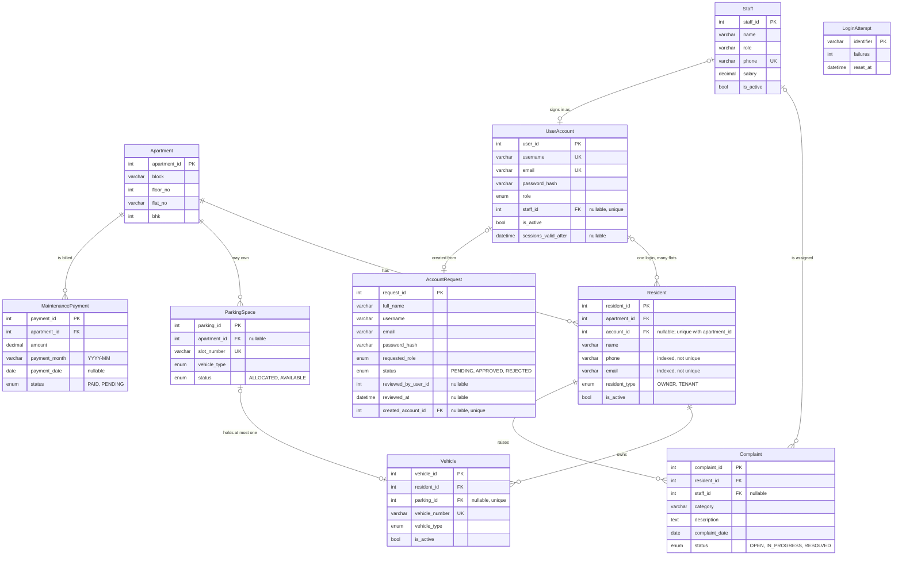

# ER diagram and schema validation

The team's own ER diagram was not in the repository (not in `docs/`, the implementation guide or the proposal), so it could not be diffed directly. This file is the diagram **generated from the schema that is actually deployed**, plus a check of that schema against every rule in section 4 of `docs/Implementation_Guide.pdf`. Overlay it on the team's diagram to compare; the only intended differences are listed in the README under "Changes from the lab baseline".

## Diagram

Every table also carries `created_at` and `updated_at`. MongoDB collections (`visitors`, `notices`, `feedback`, `complaint_activity`) are documented in the README; they reference MySQL rows by id and are not part of this diagram.

## Validation against the implementation guide (section 4)

Checked by introspecting the live MySQL database (`information_schema`) after `npm run db:setup`.

| Guide rule | Result |
| --- | --- |
| Seven agreed core tables kept with their names and meanings | Pass: Apartment, Resident, Staff, ParkingSpace, Vehicle, MaintenancePayment, Complaint |
| `UserAccount` supporting table included, password hashes only | Pass: `password_hash` only; resident logins linked from one or more `Resident` rows, staff logins to one `Staff` row, admins standalone |
| Apartment 1-to-many Resident, ParkingSpace, MaintenancePayment | Pass: three foreign keys to `Apartment` |
| Resident 1-to-many Vehicle and Complaint | Pass |
| Staff 1-to-many Complaint, complaint may be unassigned | Pass: `Complaint.staff_id` nullable, `ON DELETE SET NULL` |
| Vehicle may reference a parking slot; a slot cannot hold several vehicles | Pass: `Vehicle.parking_id` nullable with a unique index; type compatibility enforced in the API |
| DECIMAL for money, never FLOAT | Pass: `MaintenancePayment.amount` and `Staff.salary` are `DECIMAL(10,2)`; no float or double columns |
| Indexes on foreign keys and filtered columns | Pass: every foreign key is indexed; status and role columns are indexed |
| Unique `(apartment_id, payment_month)` | Pass: `MaintenancePayment_apartment_id_payment_month_key` |
| Avoid deleting records with payment or complaint history | Pass: `ON DELETE RESTRICT` from Resident, Vehicle, Complaint and MaintenancePayment to their parents; deactivation via `is_active` |
| Document every migration the agent adds | Pass: see below |

## Migrations added

| Migration | Purpose |
| --- | --- |
| `20261030000000_init` | The full schema, including `UserAccount` |
| `20261030010000_session_revocation` | Adds nullable `UserAccount.sessions_valid_after` so logout can revoke issued tokens |
| `20261030020000_login_throttle` | Adds standalone `LoginAttempt` table (no foreign keys) for the shared sign-in throttle |
| `20261031000000_account_requests` | Adds `AccountRequest` (sign-up requests awaiting admin approval) with a nullable unique foreign key to the account it produced |
| `20261031010000_multi_flat_residents` | Moves the login link to `Resident.account_id` so one person can have several flats; copies existing links before dropping `UserAccount.resident_id`; resident phone/email no longer unique |

No conflicts with the guide were found, so there is nothing to stop and report.
